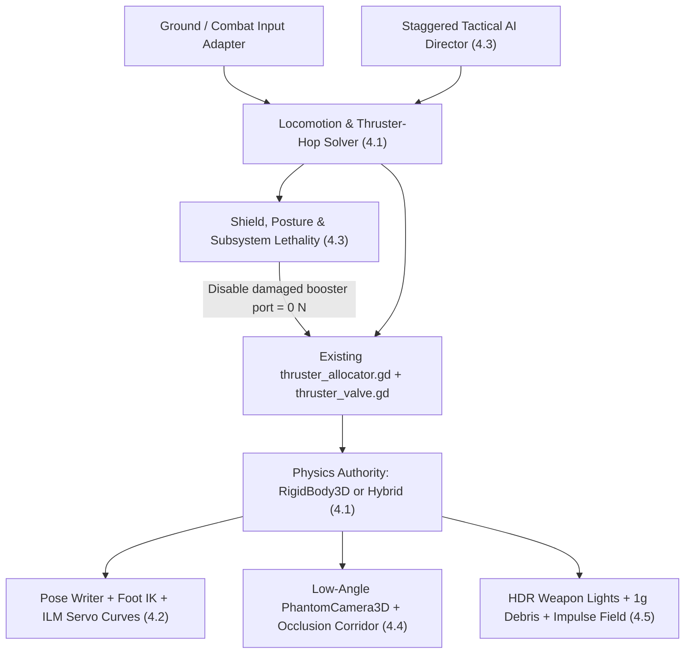

# Ground Combat Direction: Gundam Hathaway Grunt MS Study

## 1. Scope, Target Reference, and Evidence Standard

**Status:** Research and architectural options only (no code or asset changes).

The target experience is **Universal Century mass-production ("grunt") mobile suit ground combat** as depicted in *Mobile Suit Gundam Hathaway* (*Senkō no Hathaway*, 2021) and the opening ground-warfare sequence of *Mobile Suit Gundam Hathaway: The Sorcery of Nymph Circe* (2026). Specifically, two canonical reference sequences anchor every design option in this document:

1. **The Opening Grunt Raid (Davao Night Assault & *Circe* Ground-Level Skirmishes):** Mafty's **Me02R-F01 / F02 Messer** (`23.0 m` head height, `30.4 t` empty / `~68 t` combat load) clashing with Earth Federation **FD-03-00 Gustav Karl Type-00** units (`22.0 m` head height, `29.0 t` empty / `60.0 t` full load) across dense urban blocks, parks, and smoke-choked battlefields.
2. **Gawman Nobile Grounded in Davao:** After Gawman's Messer loses its *Galcezon* sub-flight system (SFS) advantage and is knocked down to street level, combat shifts from low-altitude aerial trading to claustrophobic, dust-blinded urban survival—culminating in structural collateral collapse, shield attrition, a flanking tackle, and an instant mission-kill when a pursuing Gustav Karl drives a beam saber through the Messer's back.

### Why Grunt MS Combat Differs from Ace Flight Combat

Unlike fifth-generation Minovsky Flight prototypes (*RX-105 Ξ Gundam* and *RX-104FF Penelope*) that float effortlessly in 1G, **grunt mobile suits cannot hover for free**. Once off an SFS sled, a Messer or Gustav Karl is a `60+ ton` bipedal machine fighting gravity:

- **Mobility is ballistic and high-commitment:** Ground traversal alternates between heavy bipedal strides, short violent thruster hops/lunges with visible ignition lag and dust blast, and high-friction braking slides that tear up pavement.
- **Urban architecture is waist-to-shoulder cover, not ankle-high clutter:** At `22–23 m`, a 5–8 story building (`18–30 m`) acts like a chest-high wall or destructible sniper bunker, while trees (`8–12 m`), streetlights, and vehicles provide constant human-scale rulers.
- **Exchanges are lethal, not spongy:** Survival depends on physical shields, cover, smoke occlusion, and thruster spacing. Once a suit's posture/guard breaks or its flank is exposed, a single clean beam-rifle shot or beam-saber thrust ends the fight immediately.

### Evidence Standard

Following the repository convention in `GRASS_RESEARCH.md` and `demo/aerial/README.md`, Section 3 separates **documented production techniques** (from *CGWORLD* interviews, GDC Vault lectures, and *FXGuide* breakdowns) from **proposed Godot 4 adaptations** in Section 4. No unpublished proprietary source code or engine internals are assumed.

---

## 2. Anatomy of the Hathaway Target Scenes

To translate *Hathaway*'s Davao raid and Gawman's grounding into testable game systems, the cinematic effect can be decomposed into six physical and perceptual rules:

| Cue | Reference Moment in *Hathaway* | Physical / Perceptual Mechanism |
| --- | --- | --- |
| **1G Ballistic Rulers** | Messer head vulcans firing over Tasadai Hotel / park; concrete chunks falling from blasted facades. | From `h = 22 m`, freefall under $g = 9.81\text{ m/s}^2$ takes $t = \sqrt{2h/g} \approx 2.12\text{ s}$. Uncheated `2+ second` fall times on brass casings, sparks, and rubble force the viewer's brain to perceive giant height. |
| **Cushion-Burn Touchdowns & Hop Commitment** | Messer detaching from *Galcezon* and hopping between Davao blocks; Gustav Karl drop-ins. | Main calf/skirt/backpack verniers fire *before* touchdown to arrest vertical sink, blasting dust radially outward; knees still compress deeply (`1.5–2.5 m` pelvis sink) on impact with audible hydraulic groan. |
| **60-Ton Structural Consequence** | Gustav Karl stepping onto an urban structure whose roof collapses beneath its foot; asphalt cracking on braking plants. | Terrain is not infinitely rigid. Stepping or sliding transfers megajoule impulses that crush weak roofs, flatten trees/vehicles, and leave persistent gouges. |
| **HDR Weapon Glare in Dark Atmosphere** | Nighttime beam-rifle bolts flash-igniting palm trees; beam-saber ignition flooding smoke with magenta/pink bounce light. | Ambient night illumination is kept very low (`neo-noir` contrast). Weapons and thrusters act as transient high-intensity 3D light sources that silhouette mechs against their own smoke and trigger veiling glare. |
| **Shield Attrition & Directional Defense** | Gawman angling the Messer's left-arm shield against incoming EFF fire until suppressed and stripped. | The shield is a physical world-space collider and finite ablative resource, not a 360-degree regenerating bubble. Flanking around the shield arm is fatal. |
| **Sudden Close-Quarters Neutralization** | Second Gustav Karl tackling Gawman's grounded Messer and plunging a beam saber into its dorsal torso. | Melee is neither floaty combo juggling nor chip damage. It is a committed close-range grapple/thrust against a staggered or pinned target, producing violent molten spark showers and immediate actuator shutdown. |

---

## 3. Underlying Techniques of the Four Reference Productions

### 3.1 Sunrise (Bandai Namco Filmworks Studio 1 / D.I.D., Sublimation & YAMATOWORKS) — *Gundam Hathaway*

Published interviews in *CGWORLD* (Vol. 275 and Vol. 276) with director Shūkō Murase and CG directors Tomohiro Fujie and Takayuki Masuo establish four foundational pipeline choices that give *Hathaway* its grounded live-action feel:

1. **3D Layout First (`3DLO` / "Moving Background Art"):**
   Rather than drawing unconstrained 2D mecha storyboards and forcing environment scale to fit, Murase constructed scenes in 3D space first (using Blender and Autodesk 3ds Max) mapped to real-world Davao location photography. Virtual cameras were restricted to physical cinema focal lengths (`24–35 mm` wide lenses from street/pedestrian height looking up through trees and signage; `100–300 mm` compressed telephoto lenses from distant rooftops or aircraft) with realistic tripod/handheld pan lag.
2. **Cel Shading Driven by Real 3D Scene Lighting (3ds Max + PSOFT Pencil+ 4 + AE HDR):**
   Traditional anime mecha pipelines shade mobile suits with a single static directional key light and composite 2D beams in post. Under Murase's direction, beam shots, beam sabers, muzzle flashes, thruster plumes, and urban fires were placed directly in 3D space so `Pencil+ 4` stepped cel ramps and linework reacted accurately to localized colored bounce light, rim lighting, and cast shadows, before high-dynamic-range optical glare and atmospheric haze were composited.
3. **Decoupled Camera Cadence vs. Keyframed Mechanical Weight:**
   Camera movement and background parallax run smoothly on `1s` (`24 fps` continuous) so spatial depth reads like live-action film, while mobile suit limbs are hand-keyframed (no raw human mocap) with deliberate anticipation, hydraulic settle, and selective frame holds (`2s`/`3s` or clamped curves) on heavy impacts.
4. **Hybrid Houdini + 2D *Sakuga* Secondary Elements:**
   Environmental destruction, billowing pyro smoke, ejected vulcan casings, and molten beam-saber sparks combine 3D rigid-body/fluid trajectories (for perspective and `1g` timing accuracy) with graphic, stepped-value silhouettes so VFX never clash with cel-shaded armor.

### 3.2 Industrial Light & Magic (ILM) — *Pacific Rim*

In *FXGuide* and SIGGRAPH post-mortems on *Pacific Rim* (2013), ILM Animation Supervisor Hal Hickel and VFX Supervisor John Knoll documented how they solved the central physics paradox of giant-robot combat:

1. **The Pendulum Scale-Speed Paradox ("Power Driving Mass"):**
   Strict Froude/pendulum scaling ($T \propto \sqrt{L}$) dictates that a `25–75 m` biped moves `3×` to `7×` slower than a human—which feels sluggish and underwater in combat. Conversely, moving at human motion-capture speed makes a giant robot look like an action figure. ILM **banned motion capture** for Jaegers and used a three-phase keyframed velocity curve:
   - **Slow, high-inertia initiation:** Heavy resistance and torso/pelvis wind-up required to overcome static mass.
   - **Violent powered mid-stroke:** Nuclear/reactor-driven actuators accelerate the limb rapidly through the strike arc so hits feel punchy and dangerous.
   - **Clamped mechanical arrest (zero rubbery bounce):** Impacts and stops terminate in a hard hydraulic lock, structural shudder, and damped settle rather than smooth organic ease-out curves.
2. **Proximal-to-Distal Kinematic Lag & Asynchronous Secondary Motion:**
   When throwing a punch or swinging a weapon, the pelvis and torso rotate first, the shoulder follows, and the heavy forearm/weapon drags slightly behind before whipping into alignment. Secondary mechanical sub-assemblies (piston rods, armor flaps, vernier bells) lag and settle a few frames after the primary skeleton stops.
3. **Foreground Parallax & "Terrified Human Cameraman" Rules:**
   Hickel's early walk-cycle tests proved that a giant robot in an empty frame looks small regardless of polycount. Scale popped immediately when tracking **perpendicular to the line of action behind fast-moving foreground buildings, lamp posts, and traffic**, combined with low camera placement, aerial perspective haze across city blocks, and camera shake/zoom corrections that *react late* to impacts rather than anticipating them.
4. **The "Hokusai Wave" Granularity Rule:**
   Secondary fluid, spark, and debris elements must never be scaled up into coarse blobs. Fine spray, hundreds of small concrete fragments, and `1g` fall speeds provide the micro-detail against which a `22–75 m` hull reads as colossal.

### 3.3 Respawn Entertainment — *Titanfall* & *Titanfall 2*

Across GDC lectures (*"Solving Titan-Sized Problems: Evolving Titan Combat in Titanfall 2"* by Carlos Pineda) and Respawn's animation/audio breakdowns (Shawn Wilson, Moy Parra), Respawn solved how to make heavy mechs **playable and tactically deep** rather than sluggish walking tanks:

1. **Fighting-Game / MOBA Combat Pacing Instead of Twitch Shooter:**
   Respawn discarded twitch FPS conventions (instant air-strafing, low TTK peek-shooting) for Titans. Titan duels are built on **fighting-game spacing ("footsies"), discrete dash charges (stamina-gated horizontal bursts with recovery frames), directional active defenses (Vortex/Thermal/Particle shields), and punishable cooldown commitments**. Positioning around cover lanes matters more than flick-aiming.
2. **Chassis Weight Profiles & Frame-Synced Audio-Kinematic Footfalls:**
   Light (*Stryder*), Medium (*Atlas*), and Heavy (*Ogre*) rigs use distinct acceleration envelopes, dash counts, turn rates, and stride cadences. Crucially, animation and sound are authored as a single unit: pre-step actuator whine leads limb lift, terrain IK plants the foot without sliding, pelvis compression (`ground_sink`) peaks a fraction of a second after heel strike, and layered metallic clunks + sub-bass thuds sell `40–60 ton` mass even in responsive gameplay.
3. **Dual-Scale ("Swiss Cheese") Urban Map Design:**
   Maps simultaneously weave **Titan-scale macro lanes** (wide streets, courtyards, waist-high rooftops) with **human-scale micro architecture** (interior hallways, second-story windows, pedestrian walkways, parked trucks, trees). Even if the player never exits the mech, seeing human-sized doorways, cars, and trees at shin-to-chest height continuously anchors scale and creates tactical sightline breaks.
4. **Pose-Matched Close-Quarters Transitions ("Terminations"):**
   When a damaged Titan is melee-punished in CQC, dynamic gameplay blends seamlessly into a synchronized two-actor mechanical grapple/execution—the exact interactive equivalent of the Gustav Karl tackling and back-stabbing Gawman's grounded Messer.

### 3.4 Sucker Punch Productions — *Ghost of Tsushima*

Sucker Punch's GDC 2021 sessions—Chris Zimmerman (*"Master of the Katana: Melee Combat"*), Theodore Fishman (*"Honoring the Blade: Lethality and Combat Balance"*), Matt Vainio (*"VFX of Ghost of Tsushima"*), Eric Wohllaib (*"Procedural Grass"*), and the graphics team (*"Real-Time Samurai Cinema"*)—solve four gameplay problems that usually ruin grounded melee/mid-range combat:

1. **"Honoring the Blade" — Mutual Lethality & Posture/Stagger Separation:**
   To avoid immersion-breaking "baseball-bat" health sponge fights while keeping combat longer than one second, *Ghost of Tsushima* separates **Guard/Stagger ("Posture")** from **Lethal Health**. Strikes clash against guard and erode stability; once posture breaks, `1–2` clean strikes kill either enemies or the player. Mapped to *Hathaway*, **shields, armor angling, and actuator balance** absorb the exchange until a stagger, flank, or knockdown opens an instant lethal window.
2. **Responsive Controls Inside Heavy, Grounded Animations (Phased Cancel Windows):**
   Zimmerman detailed how Jin feels weighty and planted without input sluggishness: every heavy action is divided into strict frame phases:
   - **Pre-commit wind-up:** Body shifts weight visibly, but the player can still cancel into block/parry/dodge if an incoming threat appears.
   - **Active commitment:** Mass is in motion; no weightless mid-swing cancellation is allowed.
   - **Early-cancelable recovery:** Follow-through settles heavily if left idle, allowing ILM-style weight to read, *or* branches cleanly at foot-plant frames into the next step/guard.
3. **Group Combat Readability Without Tunnel-Vision Hard Lock:**
   In 1-vs-many fights (like Gawman's lone Messer surrounded by Gustav Karls), Sucker Punch avoided a rigid single-target camera lock at launch. Instead, AI combatants coordinate via an **attack-token / staggered-wave director** and use **clear, sweeping initial wind-ups** (long telegraph on step 1, faster follow-through) so the player can read peripheral threats inside a wide cinematic frame.
4. **Systemic Interactive Environment ("Wind, Ash, Mud, Sparks") & View-Corridor Clearing:**
   VFX do not play in isolation: global wind plus local combat/movement vector fields push grass, leaves, embers, dust, and smoke simultaneously, while characters accumulate dynamic mud/scorch states. Meanwhile, procedural foliage/debris in the camera-to-player sight corridor bends or dithers away so low-angle Kurosawa framing never blinds combat readability.

### Cross-Production Synthesis

| Giant-Mech Failure Mode | Primary Reference Solution | Resulting *Hathaway* Ground Feel |
| --- | --- | --- |
| Looks like a toy in a miniature diorama | **Sunrise** (`3DLO` lenses + HDR weapon light in dark haze) & **ILM** (`1g` secondary debris + foreground parallax) | Towering, terrifying `22–23 m` silhouette lit by its own muzzle flashes and burning streets |
| Feels floaty / weightless like an action figure | **ILM** (no mocap; slow start $\rightarrow$ powered surge $\rightarrow$ hydraulic clamp; proximal-to-distal lag) | Heavy `60-ton` mechanical inertia that still hits with violent reactor-driven speed |
| Controls feel like driving a sluggish turret | **Titanfall** (discrete thruster dash/shield economy) & **Ghost of Tsushima** (phased cancel windows + strict foot-plants) | Deliberate tactical commitment with crisp defensive reaction windows |
| Combat degenerates into bullet-sponge circle-strafing | **Ghost of Tsushima** (Posture/Guard break $\rightarrow$ 1-hit lethality) & **Titanfall** (lane cover + CQC terminations) | High-tension urban cover fights ending in decisive beam shots or brutal saber takedowns |
| Grounded street chaos obscures player vision | **Ghost of Tsushima** (wide dynamic camera, staggered AI telegraphs, view-corridor occlusion fade, systemic wind clearing smoke) | Readable 1-vs-many urban survival amidst dense buildings, trees, and smoke |

---

## 4. Architectural Options for This Project (Godot 4.7)

This repository already contains substantial building blocks across `src/`, `demo/aerial/`, and `demo/actors/mechs/`:

- **Physics & Propulsion (`demo/aerial/`):** Native `RigidBody3D` (`aerial_mech.gd`), point-force hot/cold allocation (`thruster_allocator.gd` with per-port Newton ratings where `0` disables a damaged booster), finite ignition/rise/decay valves (`thruster_valve.gd`), and `10 world units = 1 m` hero scale (`display_scale = 50.0` in `aerial_demo`, `visual_scale = 0.3` in factory demo).
- **Procedural Rigging (`demo/aerial/`):** Single `SkeletonModifier3D` pose writer (`flight_pose.gd`), plain-data joint offsets (`arm_pose.gd`, `mech_rig_profile.gd`), critically damped speed-bounded servos (`pose_servo.gd`), native `TwoBoneIK3D` stance plants + sole alignment (`contact_pose.gd`), and `pose_studio.tscn`.
- **Camera (`demo/aerial/flight_camera.gd`):** `PhantomCamera3D` + `PhantomCameraHost` on manual render-clock evaluation with acceleration lag, velocity lead, and target focus.
- **Rendering & VFX (`src/` & `demo/shaders/`):** `HGStandard`-style cel shader with Bayer `N·L` dither (`cel-material.gdshaderinc`), Forward+ depth/normal Sobel outlines (`ror2-outline-effect.gd`), quarter-res volumetric scattering + HDR veiling glare (`atmosphere-volume.glsl`), deterministic drag/gravity mesh explosions (`graphic_explosion.gd`, `mesh-vfx.gdshader`), and GPU proximity-bending grass (`wind-grass.gdshader`).

Below are the concrete architectural options across five core subsystems, preserving the single-responsibility boundaries established in `REFACTOR_PLAN.md`.

---

### 4.1 Ground Locomotion & Physics Authority

How should a `60-ton` grunt MS walk, pivot, thruster-hop, brake-slide, and get knocked down?

#### Option 4.1A — Unified Force-Driven `RigidBody3D` ("Grounded Extension of `aerial_mech.gd`")
Keep `RigidBody3D` as the single motion authority for both ground and air. Add a **grounded stance-traction controller** that applies horizontal drive/braking forces and upright stabilizing moments *only* while `contact_pose.gd` reports valid stance support (`Support.GROUNDED`), capped by surface friction ($\mu N$). Exceeding $\mu N$ after a high-speed thruster hop naturally produces an **asphalt-tearing ground slide** until friction + retro-verniers arrest momentum. Short hops reuse `thruster_allocator.gd` and `thruster_valve.gd` directly (with ignition delay and fuel/heat cost) without enabling sustained `1×` hover.

- **Best for:** Seamless air-to-ground transitions—specifically **Gawman's Messer getting clipped mid-air, crashing onto a street, sliding into cover, and fighting on foot** with zero state-handoff seams.
- **Trade-offs:** Stepping over jagged urban curbs/rubble with a single `CapsuleShape3D` requires a short vertical suspension ray/spring or beveled colliders so feet do not snag; melee lunges must be driven by bounded force envelopes rather than exact root-motion curves.

#### Option 4.1B — Dual-Mode Kinematic/Dynamic Hybrid (`CharacterBody3D` Ground $\leftrightarrow$ `RigidBody3D` Ballistic/Crash)
Use `CharacterBody3D` (`move_and_slide()` with floor snapping, stair-stepping, and authored deceleration curves) whenever grounded—upgrading `demo/actors/mechs/mech_character.gd`—and hand off transform + linear velocity to `RigidBody3D` only during ballistic thruster jumps, aerial drops, or heavy knockdowns.

- **Best for:** Tight, frame-exact *Ghost of Tsushima* melee spacing, reliable urban stair/curb traversal, and deterministic AI pathing (`NavigationAgent3D`).
- **Trade-offs:** Violates `demo/aerial/README.md`'s single-body non-override principle unless handoff boundaries (liftoff, cushion-burn, crash-landing slide) are carefully synchronized; requires maintaining two collision/movement paths.

#### Option 4.1C — Stride-Phase Gait Envelope Over Kinematic or Force Capsule
Regardless of 4.1A or 4.1B, replace constant planar speed (`controls.gd`) with a **phase-coupled bipedal velocity curve**: planar acceleration pulses during single-leg push-off, dips slightly on heavy heel-strike (`impact_sink`), enforces a committed **pivot step** when desired heading differs from pelvis facing by $> 45^\circ$, and locks lateral circle-strafing behind either slow heavy side-steps or a discrete thruster hop.

| Criterion | 4.1A: Unified `RigidBody3D` + Traction | 4.1B: Hybrid `CharacterBody3D` $\leftrightarrow$ `RigidBody3D` | 4.1C: Stride-Phase Gait Layer (Add-on) |
| --- | --- | --- | --- |
| Air-to-ground crash & slide continuity (Gawman scene) | **Native / Exact** | Requires handoff state machine | Enhances either |
| Reuse of `thruster_allocator.gd` & `thruster_valve.gd` | **Direct (100%)** | Partial (airborne/hop only) | N/A |
| Urban curb / stair / slope reliability | Needs suspension spring tuning | **Native (`move_and_slide`)** | Respects host solver |
| Frame-exact melee lunge / stagger distance | Approximate (force-integrated) | **Exact (curve-driven)** | Exact stride locking |

---

### 4.2 Skeletal Animation & Mechanical Weight

How do we achieve ILM's non-mocap mechanical inertia, Sunrise's heavy silhouettes, and *Ghost of Tsushima*'s responsive cancel windows on `MechAsset.glb`?

#### Option 4.2A — Procedural Gait + Asymmetric Servo Vocabulary (Extend `flight_pose.gd` & `pose_studio.tscn`)
Keep the existing **four-modifier architecture** (`SpringFlightPose` full-body writer + two `TwoBoneIK3D` foot solvers + `SoleAlignmentAndPoseComplete`). Replace the imported `Walk`/`Run` clip dependency with a procedural stride-phase generator and compact key poses authored in `pose_studio.tscn` (heavy guard, shield-brace, rifle shoulder-fire, thruster-hop tuck, braking-slide squat, saber wind-up/thrust, stagger reel). To get ILM's *"slow start $\rightarrow$ fast reactor surge $\rightarrow$ hydraulic clamp"* instead of uniform critically damped smoothing, extend `pose_servo.gd` (or wrap it) with:
- **Slew-rate initiation lag + asymmetric arrest:** Separate acceleration limit vs. hard-stop clamp at joint targets, with zero underdamped ringing.
- **Proximal-to-distal lead/lag:** Pelvis yaw/lean updates immediately on pre-commit input, torso follows `+40–70 ms`, shoulder/shield/rifle lags `+80–120 ms` during swing and whips into a clamped lock.

- **Best for:** Zero external DCC re-export loop, continuous adaptation to uneven rubble via `contact_pose.gd`, and keeping `MechAsset.glb`'s animated shin/calf thruster mounts physically valid.
- **Trade-offs:** Multi-beat paired animations (e.g., Gustav Karl pinning Messer and drawing a saber) are harder to choreograph purely in joint-angle resources.

#### Option 4.2B — Authored Keyframe Combat Library (`AnimationTree`) + Procedural IK/Additive Layers
Author dedicated heavy mech clips in Blender (or baked via `bake_pose_library.gd`) using stepped/clamped mechanical F-curves, driven by an `AnimationTree` state machine with **explicit frame-metadata tracks** for *Ghost of Tsushima* cancel windows (`can_shield_cancel`, `committed`, `can_hop_cancel`, `foot_plant_lock`), while `contact_pose.gd` (`TwoBoneIK3D` + pelvis sink) and additive upper-body recoil/hit-twitch run as post-modifiers.

- **Best for:** Heroic bespoke choreography, weapon-draw animations, and synchronized two-mech takedowns (*Titanfall* Terminations / Gustav Karl backstab).
- **Trade-offs:** Higher authoring burden; imported `Shin` intermediate-bone bending must still yield to `contact_pose.gd` during stance (already solved in `contact_pose.gd:178`).

#### Option 4.2C — Hybrid Split: Procedural Lower-Body/Slides/Aiming + Authored High-Commitment Upper-Body/CQC Beats
Use Option 4.2A for locomotion, pivot steps, thruster-hop landings, braking slides, shield angling, and recoil, while reserving short authored clips in `pose_studio.tscn` for high-commitment melee thrusts, tackles, and catastrophic stagger/shutdown collapses.

---

### 4.3 Combat Loop, Lethality, and Subsystem Damage

How do we make combat play like Gawman vs. the Gustav Karls—tense, tactical, and lethal—instead of an arcade DPS race?

#### Option 4.3A — "Shield + Actuator Posture + Lethal Core" (*Ghost of Tsushima* $\times$ UC Gundam)
Model each grunt MS with three distinct combat states rather than one large HP pool:
1. **Physical Left-Arm Shield (`Area3D` / bone-attached collider):** Blocks beam rifles and missiles along its real posed surface normal. Absorbs `3–5` direct beam hits via ablative degradation before shattering or getting stripped, imparting heavy backward slide momentum (`RigidBody3D` impulse) and posture load on each block.
2. **Actuator Stability ("Posture") & Propellant/Valve Budget:** Hard landings without a cushion burn, shield blocks, vulcan/grenade concussions, and physical tackles fill a **Stability Overload** meter; thruster hops consume finite propellant/thermal headroom and obey `thruster_valve.gd` minimum cooldowns. Filling Stability triggers a **`1.5–2.5 s` Grounded Stagger / Knee-Drop** (arms open, shield off-line, gyro saturated).
3. **Lethal Unshielded Penetration & Live Subsystem Loss:**
   - Clean unshielded beam-rifle or beam-saber hit to **Torso/Cockpit** = immediate mission-kill (molten spark shower + reactor/actuator power-down).
   - Hit to **Head** = main camera/sensor degradation (HUD flicker, loss of target-focus markers—mirroring Penelope kicking Gawman's Messer head).
   - Hit to **Leg / Backpack Thruster** = set that port's entry in `main_booster_max_thrust` to `0.0` (already natively supported by `thruster_allocator.gd`!), causing asymmetric thrust, crippled hop height, and forced ground-only survival.

#### Option 4.3B — *Titanfall* Tactical Brawler Economy
Higher hull HP (`6–10` rifle hits to kill), regenerating directional energy/vortex shield, `1–2` regenerating horizontal dash charges (`5–7 s` cooldown), and cooldown-gated shoulder ordnance (smoke screen, micro-missiles, vulcan burst) culminating in a close-range Termination prompt when an enemy enters "Doomed" state.

- **Best for:** Longer, forgiving player-vs-AI duels with readable resource management.
- **Trade-offs:** Loses some of *Hathaway*'s raw one-mistake terror unless "Doomed" state triggers early.

#### Option 4.3C — Staggered Group AI Choreography (1 Messer vs. 2–3 Gustav Karls)
Directly apply *Ghost of Tsushima*'s group combat architecture to urban squads:
- **Suppression vs. Flank Roles:** Only one enemy holds the "CQC / Direct Push Token" at a time (closing through smoke with shield raised for a tackle/saber thrust, like the second Gustav Karl in Davao), while wingmen hold "Suppression / Pinning Roles" (firing telegraphed high-HDR beam bolts or vulcan bursts that force the player behind waist-high buildings or onto their shield).
- **Readable Audio-Visual Telegraphs:** Beam rifles emit a `0.35–0.50 s` high-pitched condenser charge + bright pink muzzle pre-glow before firing; CQC tackles ignite loud backpack flares before lunging, making peripheral threats readable without a sticky hard-lock camera.

---

### 4.4 Camera, Scale Framing, and Readability

How should the camera frame `22–23 m` combat so mechs never shrink into human-sized action figures?

#### Option 4.4A — Low-Slung "Street-Level Chase" Rig (Extend `flight_camera.gd` & `PhantomCamera3D`)
Adapt `flight_camera.gd` when grounded:
- **Lower the anchor:** Shift `center` from upper chest (`0.35 × display_scale` above origin) down toward **pelvis/hip height (`0.10–0.18 × height`)** with a slight upward tilt (`+4°` to `+8°`), placing the horizon low and forcing enemy mobile suits to tower above urban rooflines.
- **Tighter focal length + dynamic pull-back:** Use a narrower base FOV (`48°–54°`, roughly `35–45 mm` full-frame equivalent) during guarded ground stalking, widening subtly during thruster hops and tightening to over-the-shoulder (`38°–42°`) when bracing the rifle.
- **View-corridor occlusion dithering (*Ghost of Tsushima* rule):** Trees, streetlights, and fractured building corners *must* stay close to the camera to create ILM foreground parallax, but any prop intersecting the capsule-to-camera frustum fades via the shared screen-space `4×4` Bayer dither (`cel-material.gdshaderinc`) or bends away (`wind-grass.gdshader`), preserving sightlines in dense Davao-style streets.
- **Physically separated camera shake:** Own footsteps/landings trigger immediate low-frequency vertical pitch/heave (`pose_servo`-damped, zero high-frequency buzz); distant explosions and enemy landings trigger shake delayed by acoustic travel ($t = d / 343\text{ m/s}$).

#### Option 4.4B — UC Panoramic Cockpit Mode ("360° Linear Seat")
Add an optional first-person cockpit `PhantomCamera3D` placed inside the chest:
- Renders the outside cel-shaded world onto/behind subtle curved monitor bezel lines, pitch ladders, and optical attenuation when HDR beams flash nearby.
- When Gawman-style head/camera damage occurs, specific monitor panels crack or drop to static/wireframe thermal fallback, forcing the pilot to turn the torso to see through surviving optical sectors.
- Unmatched immersion for *Hathaway* fans, though harder for spatial awareness during 1-vs-many CQC tackles without proximity audio/radar cues.

#### Option 4.4C — *Circe* / Davao "Civilian Witness" Replay Camera
Extend `capture_mech.gd`'s replay architecture with fixed or panicked `1.7 m` street-level `PhantomCamera3D` witnesses (`28 mm` wide lens, handheld sway, autofocus/zoom lag, foreground trees and signage) to validate scale fidelity objectively against *Hathaway*'s film shots.

---

### 4.5 Cel Lighting, Atmosphere, and Systemic "Scale Ruler" VFX

How do we achieve Sunrise's *Pencil+ 4 + 3D HDR* aesthetic and Matt Vainio's systemic environmental reactivity using this repository's existing shader stack?

#### Option 4.5A — Neo-Noir Night/Dusk Palette + Transient 3D Weapon Lights
Reuse `cel-material.gdshaderinc`, `ror2-outline-effect.gd`, and `atmosphere-volume.glsl` without rewriting the core cel pipeline:
- **Darken ambient & sky fill (`aerial_lighting.gd`):** Drop base ambient luminance so unlit armor sits in deep cool slate/indigo shadow, with `ror2-outline-effect.gd` keeping silhouettes crisp only where lit or backlit against haze.
- **3D HDR Combat Lights:** Attach short-lived `OmniLight3D` nodes (with steep distance attenuation and shadow casting budgeted to the `2–4` brightest active events) to:
  - **Beam rifle bolts & sabers:** Intense magenta/pink HDR emission (`energy 8–16`) that carves hard 2-tone cel highlights across nearby buildings, smoke lobes, and both mechs' armor plates while triggering `atmosphere-volume.glsl` bloom/veiling glare.
  - **Vernier ground-impingement:** Warm amber/cyan under-lighting on calves and street asphalt during thruster hops and braking slides.
  - **Head vulcans & impacts:** Rapid 1–2 frame yellow/orange strobes.

#### Option 4.5B — Multi-Impulse Environmental Vector Field + Deterministic `1g` Secondary Rulers
Combine *Ghost of Tsushima*'s systemic environment with *Hathaway*'s ballistic scale cues:
1. **Upgrade `wind-grass.gdshader` (and foliage/ash/smoke shaders) to an Impulse Ring Buffer:**
   Instead of a single static-radius `character_position` push, pass a compact uniform array (e.g., `vec4 impulses[8]` storing `xyz = world_origin`, `w = radius_and_strength`) driven by footsteps, thruster ground blasts, beam shockwaves, and tackles. Grass, park trees, embers, and street dust all flatten radially outward in unison when a `60-ton` Messer hops or lands.
2. **True-`1g` Secondary Ballistics (Extend `graphic_explosion.gd`):**
   Reuse `graphic_explosion.gd`'s deterministic closed-form drag/gravity transport (`transport(velocity, terminal, drag, t)`) to spawn:
   - **Vulcan shell casings:** Rigid/instanced brass cylinders ejected from head sockets at `8–12 m/s` lateral velocity, accelerating downward at `9.81 m/s²` (`~2.1 s` to street impact) with delayed metallic clangs.
   - **Molten beam-saber / armor-piercing spark cascades:** High-count stretched icosphere/ribbon streaks (`mesh-vfx.gdshader`) pouring out of the entry wound during a saber stab or shield graze, bouncing off street geometry.
   - **Lingering ground dust & buoyant smoke curtains:** Low-lying dither-edged cel smoke (`vfx_bands = true`) kicked up by vernier blasts that hangs at `5–15 m` height for `6–10 seconds`, creating natural visibility cover and dramatic backlight silhouettes.

#### Option 4.5C — Crushable Urban Micro-Architecture ("Collateral Weight")
Populate combat arenas with lightweight instanced/pooled breakable props at human scale—streetlights (`8 m`), palm/park trees (`10 m`), parked trucks (`2.5 m`), glass curtain-wall decals, and brittle low-rise roof slabs (`Area3D` / static-to-debris swap on impulse threshold). You do not need expensive full-building voxel destruction: **crushing a single rooftop corner under a Gustav Karl's foot and igniting three palm trees from a missed beam bolt** sells 90% of *Hathaway*'s environmental horror at minimal frame cost.

---

## 5. Recommended Option Stack & Phased Path

If and when you move from research to prototyping in a dedicated scene (e.g., `demo/ground/` alongside `demo/aerial/`, keeping existing scenes and all 24 `tools/check_godot.py` checks untouched), the highest-leverage combination for this repository is **"The Grounded Grunt Stack"**:

| Subsystem | Recommended Choice | Why It Fits This Repo Best |
| --- | --- | --- |
| **Physics & Mobility** | **Option 4.1A + 4.1C** (Unified `RigidBody3D` + Stance-Gated Traction + Stride-Phase Gait + Valve-Delayed Thruster Hops) | Reuses `aerial_mech.gd`, `thruster_allocator.gd`, `thruster_valve.gd`, and `contact_pose.gd` directly; gives Gawman's mid-air knockdown $\rightarrow$ asphalt slide $\rightarrow$ grounded survival for free. |
| **Animation & Rigging** | **Option 4.2C** (Procedural Gait/Slides/Shield-Aiming with ILM Slew-Lag/Clamp Curves + Short Authored CQC/Stagger Clips in `pose_studio.tscn`) | Preserves the clean 4-modifier contract in `REFACTOR_PLAN.md` while allowing bespoke choreography for saber thrusts and tackles. |
| **Combat & Damage** | **Option 4.3A + 4.3C** (Physical Left-Arm Shield + Actuator Stability/Posture + 1-Hit Torso Lethality + Per-Booster Port Disabling + Staggered AI Tokens) | Directly captures *Ghost of Tsushima*'s tense lethality and *Hathaway*'s Davao squad tactics, leveraging `thruster_allocator.gd`'s existing zero-rating port support. |
| **Camera** | **Option 4.4A + 4.4C** (Low-Slung `PhantomCamera3D` Chase + Bayer-Dither Occlusion Corridor + `1.7 m` Street-Level Witness Replay Cam) | Uses the already-installed `PhantomCamera` addon and shared Bayer dither; witness cam provides an objective *Hathaway* scale benchmark. |
| **Lighting & VFX** | **Option 4.5A + 4.5B + 4.5C** (Davao Night Contrast + Dynamic HDR Beam/Vernier `OmniLight3D`s + 8-Slot Impulse Field + `1g` Casings/Sparks/Smoke + Crushable Micro-Props) | Turns existing `cel-material.gdshaderinc`, `ror2-outline-effect.gd`, `atmosphere-volume.glsl`, `graphic_explosion.gd`, and `wind-grass.gdshader` into a cohesive *Sunrise Pencil+ 4* night-battle renderer. |

### Suggested Prototyping & Verification Order (Future Work)

1. **Scale & Camera Graybox ("The Davao Block Test"):** Place two `22–23 m` `MechAsset.glb` instances inside a graybox street grid (`20 m` wide avenues, `18–35 m` mid-rise blocks, `9 m` trees, `8 m` streetlights) with both the low-slung chase camera and a `1.7 m` pedestrian witness camera before writing any combat logic.
2. **Heavy Gait, Thruster Hop, and Braking Slide:** Implement stance-gated traction + stride-phase velocity + cushion-burn landings + asphalt slide dust, validating `~2.1 s` secondary debris fall times and pelvis `impact_sink` sync with audio.
3. **Night Cel Lighting & Systemic Impulse VFX:** Drop ambient light, add HDR magenta beam / amber vernier `OmniLight3D`s, `1g` vulcan casings, lingering street smoke, and the multi-impulse grass/tree shader array.
4. **Shield, Posture, and CQC Neutralization:** Add left-arm physical shield angling/stripping, actuator posture overload, booster-port disabling, and the 2-unit Gustav Karl suppression-and-flank AI loop culminating in the rear beam-saber takedown.

---

## 6. Sources and What Each Supports

- **CGWORLD.jp — *Mobile Suit Gundam Hathaway* 3DCG Production Features** (Interviews with Director Shūkō Murase and CG Directors Tomohiro Fujie & Takayuki Masuo, Sunrise Studio 1 / D.I.D.): Establishes the `3DLO` (3D Layout) live-action lens workflow, Autodesk 3ds Max + PSOFT `Pencil+ 4` cel shading driven by 3D scene lighting, HDR beam/muzzle compositing, and Messer / Gustav Karl Davao urban combat staging.
- **FXGuide — *"Pacific Rim: Scouting, Scaling and Shooting"* / ILM Breakdowns** (John Knoll & Hal Hickel): Establishes ILM's rejection of human mocap for giant mechs, the pendulum scale-speed paradox solution (high-inertia start, reactor-powered strike speed, clamped mechanical stop), proximal-to-distal limb lag, perpendicular foreground parallax, and unscaled `1g` fluid/debris granularity.
- **GDC Vault — *"Solving Titan-Sized Problems: Evolving Titan Combat in Titanfall 2"*** (Carlos Pineda, Respawn Entertainment, GDC 2017) & **Prima Games *Titanfall* Animation Behind-the-Scenes** (Shawn Wilson, Moy Parra): Establishes fighting-game/MOBA spacing and discrete dash/shield resource economies for playable heavy mechs, chassis weight-class profiling, IK foot-plants paired with frame-synced hydraulic audio, dual-scale human/mech map design, and pose-matched CQC terminations.
- **GDC Vault (GDC 2021) — *Ghost of Tsushima* Technical & Design Sessions**:
  - *Master of the Katana: Melee Combat in 'Ghost of Tsushima'* (Chris Zimmerman): Phased animation cancel windows, foot-plant preservation, and group-combat AI attack tokens / readable initial wind-ups without rigid lock-on.
  - *Honoring the Blade: Lethality and Combat Balance in 'Ghost of Tsushima'* (Theodore Fishman): Mutual lethality balanced via Guard/Posture stagger separation rather than large HP pools.
  - *The VFX of 'Ghost of Tsushima'* (Matt Vainio) & *Procedural Grass in 'Ghost of Tsushima'* (Eric Wohllaib): Systemic world/local wind and combat impulse fields driving foliage, embers, dust, and smoke simultaneously, plus camera-corridor foliage clearing for low-angle combat readability.
  - *Real-Time Samurai Cinema: Lighting, Atmosphere, and Tonemapping* (Sucker Punch Graphics Team): High-contrast atmospheric mood lighting and silhouette-first shot composition.

