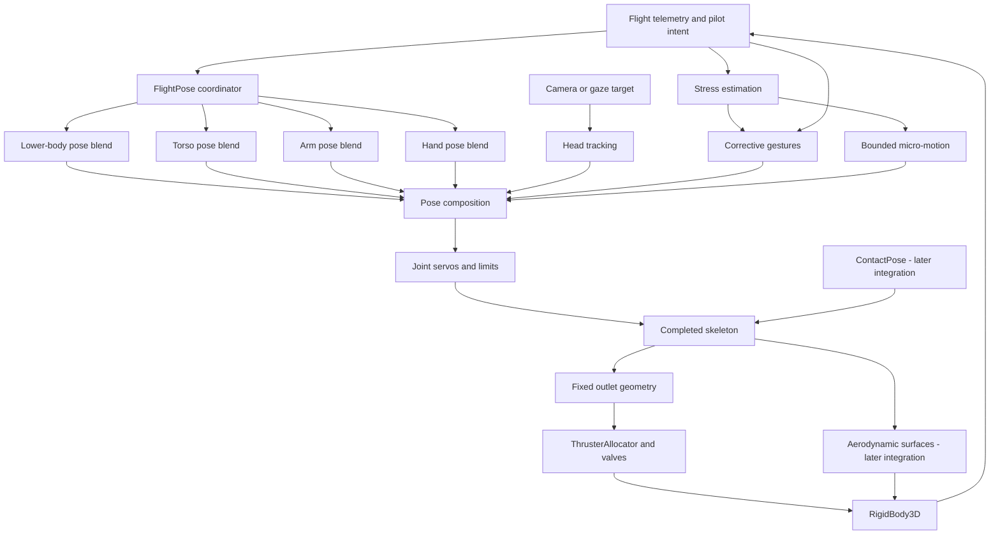

# Pose-driven aerial mech articulation

**Status: the aerial demo uses authored full-body articulation and fixed-axis propulsion. The [Flight Articulation Lab](flight_articulation_lab.tscn) remains available for the six-outlet experiment. See the [live flight implementation](#10-live-flight-implementation).**

Companion to the [mech animation research guide](../../MECH_ANIMATION_RESEARCH.md) and [aerial demo implementation notes](README.md). The current Godot runtime remains authoritative for existing behaviour. This document records the intended direction for the next flight-articulation experiment; where its aesthetic requirements differ from older flight proposals, follow this document for the experiment only.

## 1. Goals and design principles

- Isolate the pelvis and legs first in a flight pose laboratory. Establish mechanically purposeful authored poses before integrating the torso, arms, hands, head and complete controller.
- Straight legs communicate composure and speed; bent knees communicate mechanical effort; asymmetry communicates directional intent.
- Ordinary powered flight has extended legs and generally straight, compact arms. Avoid a permanent crouch or skydiver silhouette.
- High-stress flight must not look like a fixed aircraft with rigid limb ailerons. Limbs actively gather, extend, counterstroke and recover; the animation evolves even when input is held.
- Primary silhouettes are authored keyframes; procedural motion is bounded secondary articulation, not a second competing full-body controller.
- Remove independent nozzle gimbals in the experiment. The foot outlets remain fixed relative to their mounting bones. Articulate hips, knees and ankles, then allocate achievable engine magnitudes through the resulting geometry. Never secretly steer nozzles or overwrite rigid-body velocity or attitude.

| Component | Responsibility |
| --- | --- |
| Hips / thighs | Coarse thrust direction, stance width and leg orientation |
| Knees | Aggressive redirection, leverage and compression |
| Ankles | Precise foot-booster direction |
| Feet | Fixed booster outlets |
| Torso | Counterlean, directional commitment and later backpack geometry |
| Arms | Usually straight and compact, active corrective gestures under load |
| Head | Independent gaze and anticipation |
| Hands | Continuous grip and finger expression |

## 2. Lower-body flight articulation study

All angles are first-pass visual authoring targets in anatomical terms, not signed skeleton-local commands or proven force directions. Calibrate using actual mounting bases, joint conventions and completed bone transforms. Exhaust points opposite thrust. Wide/narrow stance means relative separation measured against the chassis; do not invent physical hip translations or stretch bones.

### 2.1 Pitch

| Pose | Hip orientation | Knee flexion | Stance | Ankle adjustment |
| --- | --- | --- | --- | --- |
| Neutral | Neutral | 5° | Normal | 0° |
| Soft pull up | Forward 10–15° | 5° | Normal | 10° backward |
| Hard pull up | Forward 35–45° | 80–90° | Wide | 20–30° trim |
| Soft pull down | Backward 10–20° | 5° | Wide | 10° forward |
| Hard pull down | Backward 25–35° | 5–10° | Extra wide | 20–30° forward |

Soft pull-up keeps the legs straight, hips forward and ankles slightly angled back. Hard pull-up retains the intent but introduces approximately 90° knee bend and a wide stance. Pull-down retains straight legs, widens the stance and moves hips/legs backward. The silhouette contrast is essential.

Later upper-body integration: soft pitch keeps the torso relatively rigid and hands near thighs. Hard pull-up arches and compresses the chest, with arms clearing the wider stance; hard pull-down commits the torso forward as the legs trail. These are starting silhouettes, not rigidly held poses during high stress.

### 2.2 Roll

| Pose | Leading leg | Trailing leg | Ankles |
| --- | --- | --- | --- |
| Soft roll left | Forward 10° | Backward 10° | Opposing 10° angles |
| Hard roll left | Forward 25° | Backward 25° | Opposing 20–25° angles |
| Soft roll right | Mirrored | Mirrored | Mirrored |
| Hard roll right | Mirrored | Mirrored | Mirrored |

Use narrow, extended legs, normally under 10° knee flexion. One foot advances and the other retracts, with opposite forward/backward ankle orientations. Later, add slight opposing shoulder/pelvis twist and compact arms. Test the desired pilot-axis moment and minimise unintended translation. Opposing ankle angles alone do not establish that the moment is about the correct axis.

### 2.3 Yaw — Armored Core-style lean

| Component | Soft yaw | Hard yaw |
| --- | --- | --- |
| Torso lean (later) | 10–15° | 20–30° |
| Pelvis | Slight lateral shift | Pronounced lateral shift |
| Inside leg | Slightly bent | Bent 30–45° |
| Outside leg | Extended | Extended and displaced |
| Feet | Mild asymmetric adjustment | Strong asymmetric adjustment |
| Stance | Normal | Wide |
| Arms (later) | Close to body | Close, slightly staggered |

Commit visibly into the turn rather than simply spinning. In the current fixed-inertia rigid-body model, visual leaning alone does not produce yaw. Foot axes, lever arms and differential engine output must produce the intended moment. Mirror the opposite side in the calibrated skeleton frame.

### 2.4 Translation and braking

| Pose | Leg arrangement | Foot thrust objective |
| --- | --- | --- |
| Vertical ascent | Straight, narrow | Upward force |
| Forward boost | Both legs trail, one slightly staggered | Forward acceleration |
| Backward boost | Both legs reach forward | Backward acceleration |
| Lateral boost left | One leg gathers, the other extends | Leftward acceleration |
| Lateral boost right | Mirrored | Rightward acceleration |
| Retrograde braking | Wide stance, loaded knees | Oppose current velocity |
| Unpowered coast | Relaxed straight legs | No main thrust |

Translation and rotation are independent requests. A similar-looking pose may have different force/moment requirements. Do not infer a linear boost from a rotation command or vice versa.

### 2.5 Initial pose authoring checklist

20 logical targets: **15 manually authored, 5 mirrored**. This is the lower-body experiment subset, not a count of the existing Pose Studio library. Unpowered coast appears only once.

| Family | Pose targets | Authored | Mirrored |
| --- | --- | ---: | ---: |
| Neutral | Neutral flight; unpowered coast | 2 | 0 |
| Pitch | Soft pull up; hard pull up; soft pull down; hard pull down | 4 | 0 |
| Roll | Soft roll left; hard roll left; mirrored right equivalents | 2 | 2 |
| Yaw | Soft yaw left; hard yaw left; mirrored right equivalents | 2 | 2 |
| Translation | Vertical ascent; forward boost; backward boost; lateral boost left; mirrored right; retrograde braking | 5 | 1 |
| Total | 20 | 15 | 5 |

- [x] Neutral flight
- [x] Unpowered coast
- [x] Soft pull up
- [x] Hard pull up
- [x] Soft pull down
- [x] Hard pull down
- [x] Soft roll left
- [x] Hard roll left
- [x] Soft roll right (mirrored)
- [x] Hard roll right (mirrored)
- [x] Soft yaw left
- [x] Hard yaw left
- [x] Soft yaw right (mirrored)
- [x] Hard yaw right (mirrored)
- [x] Vertical ascent
- [x] Forward boost
- [x] Backward boost
- [x] Lateral boost left
- [x] Lateral boost right (mirrored)
- [x] Retrograde braking

### 2.6 Continuous pose intensity and selection

Use neutral, soft and hard as continuous blend-space anchors, initially at intensity 0, 0.5 and 1. A 20% pull-up should barely alter the silhouette; 100% should transform it. Knee flexion should increase nonlinearly, keeping legs nearly straight through routine manoeuvres. Use bone-local interpolation, joint constraints and bounded servo response, not abrupt switches. Interpolate between compatible poses and recheck intermediate geometry; mirroring must be calibrated rather than blindly negating Euler angles.

Selection considers current velocity vector, thrust on/off (including valve shutdown tails), requested and delivered thrust vectors, their magnitudes, and the left/right output difference. Existing controller signals include velocity, requested_main_force, main_force, delivered_thrust, thrust_level, detent, motor_forces, rotation_request, effective_rates, angular_velocity, angular_acceleration, local_acceleration, local_airflow, control_torque and time_to_impact.

- Compute signed thrust alignment with travel only when both vectors are meaningful. Decompose force into parallel and perpendicular components; negative parallel force indicates retrograde thrust. Do not subtract velocity and force (different units).
- Compare requested and delivered force magnitudes in body weights for anticipation, sustained load and release. Distinguish the resultant force magnitude from the sum of individual engine magnitudes; the latter measures total effort. Equal total power can conceal directional error.
- Use requested force/torque to prepare limbs, delivered force and net acceleration to brace, and actual angular-rate error to initiate or arrest correction. Preserve momentum through cutoff and reversal. Retain the previous meaningful direction near zero speed; use demand for directional movement from rest.
- Differential engine output is a separate asymmetry signal. In the six-main fixture, group the backpack/calf/sole outlets as three left-side and three right-side engines.
- Separate gravity-supported hover from true acceleration; stable hover is not a hard drive pose. Keep airborne, coast, freefall and landing context distinct when later integrating the full system.
- Blend overlapping manoeuvres by priority/feasibility, not by summing every extreme pose. Maintain continuity on interruption and reversal.

### 2.7 Experimental scene

Reuse [Pose Studio](pose_studio.tscn), [its script](pose_studio.gd), the actual mech skeleton and [pose baker](poses/bake_pose_library.gd). Hide upper-body visuals rather than deleting skeleton dependencies. Use a fixed reference chassis, pelvis/legs and foot outlets. Keep a declared reference centre of mass and inertia for force/moment comparisons; a freely released fixture must use stated mass/inertia assumptions rather than silently changing them when meshes are hidden.

| Mode | Purpose |
| --- | --- |
| Pose authoring | Adjust hips, knees and ankles; save local keyframes |
| Force analysis | Freeze chassis; display individual and aggregate force and torque |
| Dynamic simulation | Release fixture; test real motion under declared mass, gravity and inertia |

Controls: independent left/right power, total thrust, pitch/yaw/roll demand, translational demand, pose intensity, slow motion, front/side/top views. Show actual thrust and opposite exhaust arrows, outlet axes, force lever arms and reference centre of mass.

Use all six live main hardpoints in the initial fixed-axis witness; disable cold-gas output and aerodynamic forces so the test isolates main-engine geometry. Exclude arms, acrobatics, landing IK and automatic torso corrections in the first experiment.

| Demand | Linear X (lateral) | Linear Y (support) | Linear Z (longitudinal) | Pitch | Yaw | Roll |
| --- | --- | --- | --- | --- | --- | --- |
| Pull up | Minimise unintended | Measure | Measure | Strong desired sign | Minimise | Minimise |
| Pull down | Minimise unintended | Measure | Measure | Opposite sign | Minimise | Minimise |
| Roll | Minimise unintended | Support if requested | Minimise | Minimise | Minimise | Strong desired sign |
| Yaw | Minimise unintended | Support if requested | Minimise | Minimise | Strong desired sign | Minimise |
| Lateral boost | Strong desired sign | Support if requested | Minimise | Minimise | Minimise | Minimise |

The table uses conceptual axes; transform measured results into the pilot frame and separately label world/body axes, particularly for banked and inverted attitudes. Existing W/S pitch, A/D roll and Q/E yaw semantics remain. Use SI force/moment and the existing world-unit conversion.

For each completed pose, compute resultant force F = sum(f_i d_i) and moment M = sum(r_i cross (f_i d_i)), with nonnegative capped engine magnitudes f_i, fixed bone-derived force axes d_i and lever arms r_i about the physical COM. The existing allocator has a fixed-axis path (cone = 0). Verify feasible signed moments rather than assuming a visually correct pose produces them. Report residual demand, cross-axis error, valve state and saturation. Reduce gesture amplitude or available acceleration when the pose cannot produce the requested wrench; do not invent force authority.

### 2.8 Existing rig constraints

| Constraint | Current profile defaults (rounded) |
| --- | --- |
| Maximum knee flexion | 94.5° |
| Hip pitch range (local) | −66° to +37° |
| Ankle pitch range (local) | −37° to +29° |
| Hip angular speed | 92°/s |
| Knee angular speed | 103°/s |
| Ankle angular speed | 86°/s |

The hard pull-up sits close to the knee limit. Moving from 5° to 90° takes at least approximately 0.83 seconds at the current maximum speed, before servo settling. Some proposed angles may exceed signed limits once mapped to bone axes. Clamp and inspect; change aerial joint response only after measuring the pose and input latency. Preserve grounded response and shared contact behaviour.

The full rig uses six main outlets: two backpack, two rear-calf and two foot-sole nozzles. Four additional toe outlets have been removed. Twelve cold-gas verniers are distributed across shoulder, thigh, chest, backpack and rear-waist hardpoints. All live main and cold outlets use fixed axes. The articulation laboratory now uses the same six main hardpoints, grouped by leg for side-to-side power comparisons.

### 2.9 Visual hierarchy

| Situation | Straight legs | Asymmetry | Stance |
| --- | --- | --- | --- |
| Neutral | Very high | Minimal | Normal |
| Cruise | Very high | Minimal | Narrow |
| Soft pitch | High | Minimal | Normal |
| Hard pull up | Low | Low | Wide |
| Hard pull down | High | Low | Wide |
| Roll | High | Very high | Narrow |
| Yaw | Moderate–high | High | Wide |
| Directional boost | High | Moderate | Variable |
| Emergency braking | Low | Moderate | Wide |

## 3. Upper-body articulation specification

Integrate only after the lower-body force/pose study establishes its usable envelope. Use independent but coordinated layers; avoid a separate full-body animation for every combination.

| Body part | Primary driver | Secondary driver |
| --- | --- | --- |
| Hips | Requested thrust direction | Delivered thrust |
| Legs | Manoeuvre type/intensity | Velocity and acceleration |
| Ankles | Required force and torque | Fine thrust correction |
| Torso | Manoeuvre commitment | Inertial loading |
| Shoulders | Torso movement | Counterbalance |
| Arms | Manoeuvre type | Acceleration and airflow |
| Head | Camera/gaze target | Velocity, force and anticipation |
| Hands | Effort and intention | Continuous micro-articulation |

Each part has its own response speed; avoid simultaneous identical starts/stops.

### 3.1 Head

| Situation | Preferred gaze |
| --- | --- |
| Manual camera movement | Camera viewing direction |
| Target lock | Locked target |
| Stable cruise | Velocity |
| Manoeuvre initiation | Requested force or turn direction |
| Sustained manoeuvre | Intended trajectory |
| Retrograde braking | Pilot gaze, not automatically thrust direction |
| Unpowered coast | Velocity or camera direction |
| Landing | Predicted landing location |
| Stationary hover | Last meaningful gaze direction |

Blend relevant targets smoothly with retained direction and hysteresis; avoid oscillating between conflicting force and velocity vectors. Use existing gaze_direction and bounded head servo. Head tracking has no direct force authority.

| Parameter | First-pass target |
| --- | --- |
| Horizontal rotation | ±45° |
| Look upward / downward | 50° / 30° |
| Tracking response | 100–180 ms |
| Maximum rotation speed | 90–140°/s |
| Anticipation lead | 80–150 ms |
| Neutral dead zone | 2–3° |

Current mechanical limits remain authoritative until deliberately recalibrated.

### 3.2 Torso

| Manoeuvre | Torso behaviour |
| --- | --- |
| Neutral | Upright relative to pelvis |
| Soft pull up | Slight backward arch |
| Hard pull up | Pronounced arch and load compression |
| Soft pull down | Slight forward inclination |
| Hard pull down | Strong forward commitment |
| Roll | Small opposing twist |
| Yaw | Armored Core-style directional lean |
| Forward boost | Forward lean |
| Retrograde braking | Rearward brace |
| Coast | Relax towards neutral |
| High acceleration | Compression opposite net acceleration |

Nine authored targets: neutral, arch, deep arch, forward lean, deep forward lean, lateral lean, axial twist, compressed brace, extended release. Mirror lateral lean and axial twist. Distribute across the existing four torso bones (PelvisBase, Low_Waist, Torso_WaistConnect, Torso). Avoid independent torso wriggling. Torso geometry affects backpack outlets once enabled.

### 3.3 Arms

Default straight and close to the body, with slight independent shoulder, elbow and wrist movement. The base poses are starting points, not fixed holds. Stress-driven gestures in section 4 take priority over the compact silhouette when the flight condition warrants them.

| Arm pose | Application |
| --- | --- |
| Neutral straight | Hover and routine flight |
| Streamlined | High-speed cruise |
| Trailing extension | Forward acceleration |
| Forward brace | Braking |
| Asymmetric balance | Yaw and lateral boost |
| Counterrotation | Roll initiation and arrest |
| Wide brace | Emergency braking |
| Relaxed suspension | Engines-off coast |
| Landing guard | Touchdown preparation |

Mirror asymmetric balance and counterrotation as appropriate. Reuse existing ArmPose and completed arm geometry sampling for airflow and brake spread.

### 3.4 Hands: never static

Author three families with three variants each (nine keyframes). Blend within and across families, independently for left and right hands.

| Family | Variants |
| --- | --- |
| Open | Natural open; spread fingers; extended fingers |
| Relaxed | Loose curl; natural curl; tighter curl |
| Closed | Loose fist; normal fist; hard clench |

| Situation | Hand state |
| --- | --- |
| Stable hover | Relaxed |
| Cruise | Relaxed, slightly closed |
| Full-power acceleration | Closed |
| Soft pitch | Relaxed |
| Hard pull up | Closed |
| Hard pull down | Closed or partially closed |
| Roll | Relaxed, tightening under load |
| Yaw | Asymmetric grip |
| Aerodynamic braking | Open |
| Unpowered coast | Relaxed |
| Freefall correction | Open |
| Landing impact | Closed, then release |

| Parameter | Initial value |
| --- | --- |
| Relaxed finger variation | 3–7° |
| Open finger variation | 2–5° |
| Closed finger variation | 0.5–2° |
| Variation frequency | 0.2–0.7 Hz |
| Finger-to-finger response delay | 15–50 ms |
| Rapid clench | 80–150 ms |
| Relaxation | 200–450 ms |
| Wrist variation | 1–3° |

Use low-frequency coherent variation plus event-driven grip changes. Different hand phases; correlated but nonidentical fingers. No obvious repeating sine wave, random frame-to-frame jitter or identical mirrored hands. Maintain palm contact for a closed fist and avoid armour/finger intersections. Future weapon constraints override free articulation where contact requires it; do not fake visible grip motion by clipping through a weapon.

### 3.5 Timing and inventory

For hard pull-up, head anticipates, hips/ankles establish direction, torso commits, knees enter the heavier pose, hands tighten as load develops. Thrust follows available geometry and valve delivery, never a fixed timeline. Initial timing study (seconds, illustrative): head 0–0.16; shoulders 0.04–0.26; hips 0.05–0.38; ankles 0.06–0.32; torso 0.07–0.34; knees 0.09–0.55; hands 0.12–0.32; thrust 0.20–0.62. These are aspirational choreography targets; the current knee speed cannot achieve the specified full hard-pull-up excursion in that window.

| Layer | Manually authored | Mirrored |
| --- | ---: | ---: |
| Lower body | 15 | 5 |
| Torso | 9 | 2 |
| Arms | 9 | 2 |
| Hands | 9 | Reusable per hand |
| Head | Continuous tracking | Not required |
| Total | 42 | 9 |

This is a proposed asset budget, not a claim that all keys have been authored. Corrective gestures may reuse these anchors or require additional short clips after the laboratory results.

## 4. Stress-driven secondary motion

**Intentional articulation establishes the goal; reactive articulation communicates how hard the mech is working.** Limbs should look actively controlled rather than perfect ailerons. Under high-speed/high-load manoeuvres, allow frequent, asymmetric, occasionally overlapping corrective gestures. Even stable high-speed travel should exhibit more subtle adjustments than low-speed idle, but remain more composed than a demanding turn.

### 4.1 Stress signals

| Input | Animation influence |
| --- | --- |
| Airspeed / dynamic pressure | Airflow-induced corrections |
| Delivered thrust | Mechanical loading |
| Net acceleration | Inertial bracing |
| Angular velocity | Limb placement and counterrotation |
| Angular acceleration | Sudden correction |
| Thrust–velocity misalignment | Directional articulation |
| Requested–delivered force discrepancy | Anticipation and correction |
| Residual torque | Stabilisation gestures |
| Sudden control reversal | Rapid redistribution of limb positions |

Derive bounded, smoothed stress with distinct sustained-load and transient-change influences. Normalise by declared chassis reference values and guard zero speed/thrust; measure dynamic pressure from relative airflow. Use actual vector signs/rate errors to select gesture direction. Stress is animation telemetry, not a new flight authority. High speed raises baseline variation and potential correction amplitude, while load/error determines larger frantic gestures.

### 4.2 Arm gesture vocabulary

| Gesture | Function |
| --- | --- |
| Trailing sweep | Arms move back during acceleration |
| Outward stroke | Rapid stabilising correction |
| Inward gather | Compact before rotation |
| Forward reach | Arrest rotation / brace against deceleration |
| Elbow recoil | Absorb sudden load |
| Shoulder rotation | Reorient whole arm |
| Wrist correction | Follow-through |
| Asymmetric recovery | Return one arm before the other |

Arms transition between gestures during aggressive flight without always returning to neutral. Use unequal amplitudes and timing, changing elbow flexion and shoulder rotation rather than only lateral spread. A gesture has preparation, stroke, follow-through and recovery; the next can interrupt recovery at high stress, with continuity from the current pose.

### 4.3 Leg gesture vocabulary

| Gesture | Function |
| --- | --- |
| Knee flick | Brief flexion and extension |
| Ankle counterstroke | Fast bounded thrust-direction correction |
| Hip stagger | One leg advances, the other retracts |
| Stance expansion | Widen under load |
| Stance contraction | Gather during acceleration/rotation |
| Leg scissoring | Alternating fore–aft rotational correction |
| Asymmetric tuck | One knee bends while other remains extended |
| Extension recovery | Return deliberately from extreme pose |

Do not lock legs into a single pose for an entire manoeuvre. One leg can gather or extend while the other preserves dominant propulsion. Random ankle motion at high power is prohibited; check achievable force/moment throughout the gesture.

### 4.4 Stress levels and initial motion envelopes

| Characteristic | Low | Moderate | Extreme |
| --- | --- | --- | --- |
| Arms | Close | Asymmetric adjustments | Rapid corrective strokes |
| Legs | Straight | Small stance shifts | Gathering and extension |
| Torso | Composed | Counterlean | Strong corrective commitment |
| Head | Steady tracking | Anticipation | Rapid gaze acquisition |
| Hands | Relaxed variation | Changing grip | Clenching/releasing |
| Correction frequency | 0.2–0.6 Hz | 0.5–1.5 Hz | 1–2.5 Hz |

For illustrative stress s in [0,1], the original study used the following maximum additive angular envelopes in degrees. They are ceilings, not mandatory oscillations, and must be reduced by joint, speed, collision, finger-state and force constraints.

| Joint | Illustrative envelope |
| --- | --- |
| Shoulder | ±(3 + 25s) |
| Elbow | ±(4 + 30s) |
| Hip | ±(1 + 12s) |
| Knee | ±(2 + 20s) |
| Ankle | ±(1 + 5s) |
| Finger | ±(2 + 6s), subject to grip-family bounds |

Combine authored primary poses, authored short gestures, signed telemetry-driven reactions and coherent micro-motion. Do not use pure procedural noise or looping full-amplitude sine waves. Phase and amplitude should respond to changes in physical state, not merely elapsed time. Maintain deterministic replayable variation, with limited independent phases for each side. High-stress correction frequency means opportunities to initiate gestures, not a requirement to cycle every joint through its entire range.

### 4.5 Example: aggressive high-speed bank

| Time (illustrative) | Beat | Articulation |
| --- | --- | --- |
| 0.00 s | Cruise | Straight legs, compact arms, relaxed hands |
| 0.15 s | Initiation | Head turns, leading shoulder opens, legs stagger |
| 0.35 s | Commitment | Ankles redirect thrust, one arm sweeps outward |
| 0.60 s | Correction | Opposite arm moves, inside knee gathers, grip tightens |
| 0.90 s | Arrest | Limbs counterrotate as angular demand falls |
| 1.30 s | Recovery | Arms settle independently, legs return towards cruise |

Even if input is held, animation evolves with velocity, angular acceleration, force allocation and airflow. Index gestures by events/physical progress, not a mandatory fixed 1.3-second animation. Low stress: disciplined machine. Moderate: actively controlled. High: visibly fighting loads. Extreme: aggressive overlapping corrections.

### 4.6 Physical consistency and gesture budget

| Part | Permitted secondary variation |
| --- | --- |
| Fingers | Independent continuous motion within contact limits |
| Head | Independent gaze within mechanical limits |
| Arms | Generous corrections, accounting for actual aerodynamic loads |
| Torso | Bounded; backpack geometry changes when enabled |
| Hips / knees | Constrained by outlet geometry |
| Ankles | Highest direction precision while firing |

Evaluate the actual force/moment consequences of a candidate leg gesture using completed or predicted reachable geometry. Reduce its amplitude, redistribute power using the existing allocator, or accept reduced demand when infeasible. Avoid feedback chatter: retain lead side, use hysteresis and bounded servo changes, and don't reset a gesture every tick. Use the same completed bone geometry for physics and VFX. The existing chassis uses fixed rigid-body inertia: limb weight-shift animation by itself does not create a real inertial torque or external translation. Arms can affect aerodynamic forces when surfaces are re-enabled.

## 5. Proposed architecture and reuse



| Existing path | Reuse / intended ownership |
| --- | --- |
| [flight_controller.gd](flight_controller.gd) | Demand, telemetry, force/torque, valve timing and rigid-body simulation |
| [flight_pose.gd](flight_pose.gd) | Coordinate authored pose selection, layers and corrective gestures |
| [arm_pose.gd](arm_pose.gd) | Arm/wrist/finger application and completed geometry |
| [mech_rig_profile.gd](mech_rig_profile.gd) | Joint mapping, limits and calibration |
| [pose_servo.gd](pose_servo.gd) | Bounded continuous joint transitions |
| [aerial_mech.gd](aerial_mech.gd) | Integration, outlet transforms, completed pose cache and exhaust |
| [thruster_allocator.gd](thruster_allocator.gd) | Existing fixed-axis projection and force/moment allocation |
| [contact_pose.gd](contact_pose.gd) | Ground and landing corrections when reintegrated |
| [poses/bake_pose_library.gd](poses/bake_pose_library.gd) and [pose_studio.gd](pose_studio.gd) | Authoring workflow and inspection; preserve authored assets |

The laboratory and live flight use the same lower-body anchor sheet. Grounded imported animation playback and the full-body Pose Studio studies remain available. Separate gameplay bone-local data from studio presentation/root tracks; do not let playback overwrite chassis attitude or silently rebake manually authored keys. Prefer refactoring existing paths over creating parallel runtime controllers.

Demand must prepare articulation before full thrust arrives. Use previous delivered telemetry and the latest completed pose cache for allocation; if skeleton modifiers are deferred, explicitly tolerate that latency rather than sampling partially evaluated/restored transforms. Read actual output for bracing and exhaust. Keep the existing ground animation/contact path outside the experimental changes.

## 6. Staged implementation and acceptance

| Stage | Scope |
| --- | --- |
| 1 | Isolated lower-body laboratory, 15 authored + 5 mirrored targets |
| 2 | Fixed-axis six-main-hardpoint force analysis and dynamic witness; stress gestures for legs |
| 3 | Torso poses and counterbalance |
| 4 | Shoulder, elbow and wrist gestures, stress response |
| 5 | Independent head tracking |
| 6 | Nine hand targets and continuous variations |
| 7 | Full-body flight, re-enable other outlets/surfaces deliberately and reintegrate contacts |

Before stage 3, assess whether the six fixed main hardpoints provide usable signed pitch/yaw/roll and translation authority through leg articulation. Test neutral, soft/hard endpoints, intermediate blends, diagonals, reversals, interruption, shutdown/restart, high thrust, and changing attitude. Record force/moment error, residual torque, saturation, per-side engine output, joint limits, clipping, response latency and physical/rendered outlet agreement. Compare against the gimballed numerical baseline at matched mass, input and timestep; explicitly report unsupported manoeuvres rather than inventing authority.

For full-body integration, check stable cruise versus high-speed bank, hard pull-up/down, roll arrest, combined yaw/boost, coast and relight, and landing. Review body-relative and chase views. Require readable primary silhouettes, visible independent corrective motions, no rhythmic flailing, non-static hands, no hidden gimbal steering, no velocity/attitude snaps and no grounded locomotion regression. Measure repeatability across timestep changes.

Existing regression and capture commands (run from repository root when implementing; not executed for this document):

```sh
godot --headless --path demo --editor --import --quit
for test in test_thruster_allocator test_thruster_control test_flight_controls test_air_pose test_flight_pose test_animation_contract test_bodyflight test_maneuver_intent test_acrobatics; do
  godot --headless --path demo --fixed-fps 60 --script "res://aerial/tests/${test}.gd" || exit 1
done
godot --path demo --disable-render-loop --fixed-fps 60 --script res://aerial/tests/capture_animation_contract.gd -- /tmp/animation-contract
godot --path demo --disable-vsync --fixed-fps 30 --script res://ground/tests/test_ground_movement.gd -- /tmp/ground-30
```

Existing tests that mandate gimbal travel or old procedural internal targets need a deliberate spec revision when changing runtime; keep the physical invariants. Add laboratory-specific assertions only when implementing the fixture.

## 7. Movement references

- **Gundam Hathaway:** strong silhouettes, deliberate mechanical gestures, asymmetry and momentum. See the [existing animation research references](../../MECH_ANIMATION_RESEARCH.md).
- **Armored Core VI:** directional lean, aggressive commitment, quick corrections and recovery.
- **Iron Man flight testing:** reference for limbs actively managing unstable flight under stress, not for the mech's propulsion hardware.

## 8. Open questions and evidence

Source inspection on main at 4db86a26330babadc5df47db777f8606a1dd123: rig defaults, mount layout, flight controller/allocator, pose and arm scripts, servo, baker, studio and documentation. Graphify reports pending semantic refresh and unsupported GDScript AST indexing; runtime source wins. No pose values have been validated against the actual fixed-axis force envelope; no new scene, poses, code or tests are implemented by this document.

Key risks: six-hardpoint signed-axis authority, cross-axis force, reduced quick-boost responsiveness, joint-limit mapping, armour clearance, and high-frequency corrections causing excess residual force or valve chatter. Proposed angles, timings, stress envelopes and pose counts remain subject to runtime validation.

## 9. Historical feet-only laboratory measurements (superseded)

The following measurements belong to the previous six heel/toe outlet fixture. The current articulation laboratory uses the six live backpack/calf/foot-sole main hardpoints; these numerical results must not be treated as measurements of the new layout until the updated Godot regression is run.

Open the lab from the Godot editor or run these commands from the repository root.

```sh
godot --path demo res://aerial/flight_articulation_lab.tscn
godot --headless --path demo --fixed-fps 60 --script res://aerial/tests/test_articulation_lab.gd
```

Use **Pose authoring** to edit the hip, knee and ankle of either leg. **Save key**
writes a native AnimationLibrary at `user://lower_body_keys.tres` with six
bone-local rotation tracks. **Force analysis** keeps the chassis frozen and
runs the real valve state machines. **Dynamic simulation** releases the same
fixture. Choose **Pilot blend** for continuous selection from demand, travel,
delivered output and cutoff tails. The **Intensity** control blends an
individual pose from neutral when a named key is selected. W/S, A/D and Q/E
provide rotation demand, and the translation fields independently request
lateral, vertical and longitudinal force. Keys 1/2/3 switch the front, side and
top views.

The fixture uses the full mech's 10,000 kg mass and measured capsule inertia of
80,833 / 26,667 / 80,833 kg·m² about its COM. The six backpack/calf/foot-sole
outlets are rated at 65 kN each. The comparison uses the same six mounts,
demands and mass in both solves. It changes only the cone from 0° to 30°.
Backpack forces use the completed torso transform; calf and sole forces use
their completed leg transforms, matching the live physics hardpoints.

| Pose and request | Fixed force / moment residual | 30° force / moment residual |
| --- | ---: | ---: |
| Neutral, one body weight of lift | 0.5 kN / 3.3 kN·m | 0.2 kN / 4.1 kN·m |
| Hard roll left with one body weight of lift | 16.0 kN / 121.3 kN·m | <0.1 kN / <0.1 kN·m |
| Soft yaw left with one body weight of lift | 22.2 kN / 137.0 kN·m | 2.0 kN / 39.1 kN·m |
| Left boost, 0.5 body weights laterally with support | 15.3 kN / 172.3 kN·m | 11.3 kN / 71.9 kN·m |

The earlier feet-only study delivered 26.3 kN·m against a 133.3 kN·m hard-left-roll
request, with an absolute signed ceiling of 55.3 kN·m before reserving lift. Neutral
support, signed turn moments and lateral translation were demonstrated, but that
reduced geometry lacked clean roll authority. The current six-main fixture includes
the backpack, calf and foot-sole outlets; the live full rig adds cold-gas verniers
and aerodynamic surfaces while retaining fixed main-engine axes.

The lab regression checks all 20 targets at five intensities, fixed axes and
caps, signed moments, asymmetric output, ignition, cutoff tails, relight,
inversion and native motion under the measured wrench. A triangle sweep of
the 100 poses found no intersections among the checked waist/thigh and
opposing lower-leg/foot armor pairs.

## 10. Live flight implementation

The [aerial demo](aerial_demo.tscn) enables authored flight at startup. The same
[pose sheet](poses/articulation_poses.gd) supplies the lower-body anchors to the
lab and flight. It also contains nine torso targets, nine arm targets, and nine
hand targets. Pose selection splits translation from rotation, blends diagonal
moves and ramps knees more slowly through the neutral, soft and hard anchors.
Flight uses the existing four-bone torso, joint servos and landing contact solve.

The six main outlets and twelve cold ports use their completed bone axes. Backpack, calf and foot-sole engines provide primary propulsion; shoulder/thigh and torso/backpack verniers provide cold-gas attitude control.
Independent nozzle angle stays zero through firing and valve shutdown. The cold
ports supplement the six main hardpoints when their fixed-axis force/moment solve
leaves residual attitude demand or reaches a main-engine limit. At zero speed the
full rig can use 23% of each existing cold-port rating and reaches the existing
rating at 40 m/s. The gimballed comparison starts at 15%. The solver trades
unreachable demand against the available point forces and reports saturation.
Both modes use the same body mass, inertia and valve models. Set **Authored
Flight** off on the aerial demo root before running to reproduce the gimballed
comparison.

The pose pass reads the previous delivered wrench and the current pilot demand.
The strongest load or rate error starts a correction, reversal can interrupt its
recovery, and left and right shoulders follow staggered timing. Loaded feet
receive less secondary motion. Each powered leg correction is screened against
the predicted joint-limited, valve-reachable wrench. The next physics tick uses
the completed skeleton. Target lock and camera orbit can take over the neck.
Otherwise it anticipates steering, follows travel, or looks at a landing contact.
The 28 finger joints blend from bind to the imported grip calibration, with
individual lag, finger fan and coherent variation.

Run the integrated native witness from the repository root.

```sh
godot --headless --path demo --fixed-fps 60 --script res://aerial/tests/test_authored_flight.gd
```

The witness checks compact hover, extended versus gathered pitch, signed roll
and arrest, lateral boost with yaw and reversal, valve tails and relight, landing,
independent head tracking and finger motion. It measures hot outlet axes against
rendered exhaust, and compares hard roll across 30, 60 and 120 physics ticks per
second and against the gimballed baseline. The separate laboratory regression
continues to check the six-outlet configuration.

Under powered pull-up, the full rig rotates the ankles back toward axial
thrust while keeping the gathered knee target. The six-outlet lab keeps the
untrimmed authored anchor for its force comparison. In the full-rig replay,
hard roll reached 1.465 rad/s at 60 Hz versus 1.470 rad/s on the gimballed
comparison. The peak hot-exhaust discrepancy across the tested moves was
0.47° while the next pose advanced. A sampled middle finger moved 4.42° during
relaxed hover, and all 28 finger joints changed from hover to a loaded pull.
The five aerodynamic panels keep their existing areas. Their fixed incidence
is calibrated for the authored straight-limb silhouettes. The integrated test
includes an engines-off, inverted coast at negative angle of attack to check
that the completed armor still generates signed lift.


## 11. Loaded bracing and fixed thrust revision (2026-11-26)

Review-branch implementation based on main b8ed3b6. All live outlets now have zero independent deflection, including the legacy/shared ground controller. A 30° cone remains only as an offline numerical reference in the lab. Native point forces and completed bone-relative exhaust remain authoritative.

- Project actual and requested main force against velocity in body weights. Prepare a brace while the engine spools; zero speed or zero thrust/demand cannot invent a reverse burn. Blend a continuous 32° hip-abduction/72° knee-flexion target over concurrent steering, with fast 0.10 s attack and 0.28 s release. Preserve deeper hard-pull knees. Braking flare and lateral loading also widen the stance; intentional rolls retain their compact base. Landing/takeoff retain priority.
- Heavy valves keep finite 0.06 s ignition, now use 0.40 s full-range rise/fall, 0.18 s restart and 0.16 s minimum burn. Reachable allocation tracks the existing scalar pressure on each bone-derived axis (tracking weight 6). Caps are unchanged; do not compensate for reduced authority with fictitious forces.
- Cold valves retain their fast timings. Increase reachable cold-flow penalty from 0.03 to 0.06. Apply six-channel chassis-frame residual wrench hysteresis, with half-entry exit threshold and 0.10 s dwell before small opposite requests. Reversals at least three times the entry threshold remain immediate. Prime only useful jets rather than all jets in a stale horizon plan. Useful simultaneous opposed torque couples remain allowed. No actual fuel-mass model is added.
- Current comparison/ground handling will need revalidation. These timing and pose targets are untested. Historical gimbal notes above do not describe the new live policy.

Run test_flight_propulsion_policy.gd, test_authored_flight.gd, test_articulation_lab.gd, test_thruster_allocator.gd, test_thruster_control.gd and the ground movement regression before merging. Measure brace separation and knee flexion, pressure slew, cumulative cold impulse/reversals, force/moment tracking, boost and takeoff authority.


## 12. Gundam-style propulsion hardpoints

The full rig uses six main outlets, matching the conventional mobile-suit distribution:
- Two lower-backpack bell nozzles on the Torso bone, seated on the Cube mesh.
- One canted rear-calf nozzle on each Shin bone, seated on L.3.Shin and R.3.Shin.
- One foot-sole nozzle on each Feet bone, seated on the outermost downward-facing sole triangles of L.4.Feets and R.4.Feets. These follow the completed foot pose; there are no toe-mounted main engines.

Twelve fixed cold-gas verniers form six mirrored pairs:
- Shoulder armour: L.1. Shoulder / R.1. Shoulder, attached to Shoulder.L/R.
- Front chest: UpperArmors, a rigid child of Torso.
- Upper backpack: rear-facing ports on Cube, attached to Torso.
- Thigh armour: L.1.Thigh / R.1.Thigh, attached to Thigh.L/R.
- Lower backpack sides: outward-canted ports on Cube, attached to Torso.
- Rear waist: rear-facing ports on Waist Armor, attached to Low_Waist.

The GLB mesh audit accounts for both skinned vertices and rigid mesh nodes parented to bones. It measures the live mount coordinates against actual triangles, checks exhaust axes against outward surface normals, and ray-tests the rendered nozzle housing envelope for armour obstruction. The foot-sole hardpoints were moved from the inner sole surface to the outermost downward-facing triangles. The lower-backpack side axes and rear-waist locations use measured mesh normals and parent transforms.

The main-engine rating array has six entries in MOUNTS order; cold-gas ratings have twelve entries in COLD_MOUNTS order. The first four main outlets are backpack/calf, and the final two are foot soles, matching the six-entry trim distribution.

The mesh-audit workflow enforces a maximum mount-to-surface distance of 0.02 source units and a minimum exhaust-axis/normal dot product of 0.97.
